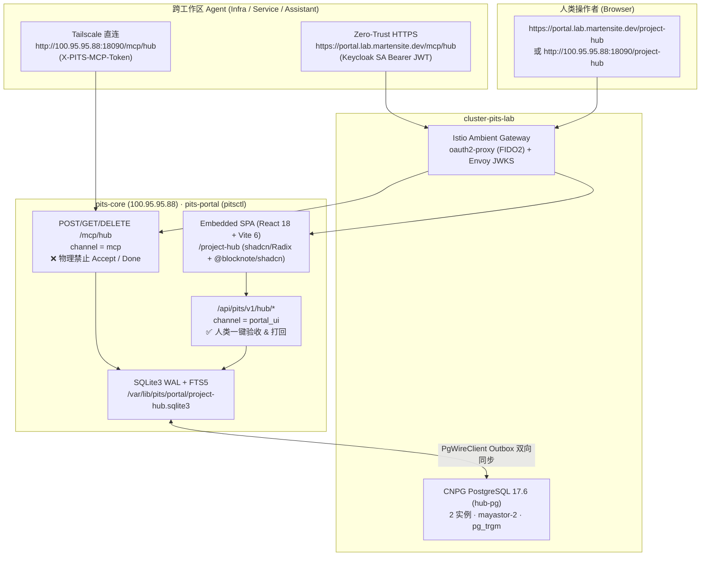

# Self-Managed Project Hub 实施规格（用户已拍板）

> **状态**：已由用户完成全部 5 项架构拍板，进入 **Phase 1 实施阶段**（由 `pits-infra` 执行落地）。
> **目标**：替代云端 Notion `Antigravity Project Hub`，消除访问延迟、OAuth `invalid_grant` 与多 Workspace 切错问题，原生融入 `pits-portal`（成为 `shadcn/ui` + `Radix UI` 替代 Backstage/MUI 原生 UI 的首个旗舰模块）并为跨工作区（`Infra` / `Service` / `Assistant`）Agent 提供双通道 MCP 与协议级人工验收硬门禁。

---

## 一、已拍板的 5 项核心架构决策

1. **技术路线与前端组件栈（方案 A1）**：
   - 采用 **PITS 原生内置 Project Hub**（复用 `pitsctl` 单二进制 Rust 服务端 + Embedded SPA），不部署 Plane / Outline / Teable，不复用 Lab Gitea Issues。
   - 前端绑定 **`@blocknote/core` + `@blocknote/react` + `@blocknote/shadcn`**（块级 Notion 文档编辑器 + 原生双向 Markdown 互转）+ **`@tanstack/react-table`**（shadcn Data Table）+ **`@dnd-kit/core` / `@dnd-kit/sortable`**（看板拖拽）+ **`shadcn/ui` & `Radix UI` + Tailwind CSS v4 + `lucide-react`**。
   - `/project-hub` 作为 `pits-portal` **去 MUI 迁移的首个旗舰模块**，沉淀可复用的 `portal/src/components/ui/*`；同时通过 **禁用全局 Tailwind Preflight（仅导入 `theme.css` + `utilities.css`，或将 reset 限定在 `.pits-shadcn-root` 作用域）** + `@source "../node_modules/@blocknote/shadcn";` 确保与存量 Backstage v1.56 / MUI v5 页面零样式回归共存。
2. **Phase 1 同步开通 `cluster-pits-lab` CNPG PostgreSQL 双轨 SSOT**：
   - 复用 `Infra/client/src/catalog/sourcing_db.rs` 同款 **SQLite3 WAL + FTS5（`pits-core` 本地热库）↔ 纯 Rust `PgWireClient`（`SCRAM-SHA-256` + TLS）Outbox 双向增量同步**架构。
   - Phase 1 同步在 **`cluster-pits-lab`** 上通过 GitOps 声明式开通 CNPG PostgreSQL 17.6 集群 **`hub-pg`**（2 实例，`mayastor-2` 持久化，`pg_trgm` 扩展，排除 `netboot-004`），通过 VLAN 20 内网安全暴露给 `pits-core`（对应 NixOS `services.pits-portal.hubDbUrlFile` -> `PITS_HUB_DB_URL`）。
3. **双 MCP 端点同时打通（Tailscale 直连 + Zero-Trust HTTPS 网关）**：
   - **端点 A（工作站高频直连，零 OAuth 过期）**：`http://100.95.95.88:18090/mcp/hub`（Tailscale 内网直连 `pits-core`，延迟 `<5ms`，支持可选静态 `X-PITS-MCP-Token` 校验）。
   - **端点 B（零信任 HTTPS 网关）**：`https://portal.lab.martensite.dev/mcp/hub`，在 `CICD/iam/clients.yaml` 注册 Keycloak 机密客户端 `pits-project-hub-mcp`（`serviceAccountsEnabled: true`），并在 `CICD/gateway/security-policies.yaml` 中为 `portal.lab.martensite.dev` 的 `/mcp/hub` 路径增加窄范围 Envoy JWT 放行规则（校验 `azp == "pits-project-hub-mcp"`），**完全不削弱浏览器人类路径（`/`、`/api/pits/v1/hub/*`）的 `acr == "fido2"` 强制门禁**。
4. **单顶层项目 + 一等标签（Tags）体系**：
   - `hub_projects` 维持单个顶层项目 **`PITS`**（`id = "pits"`，`workspace_path = "c:/Project/PITS"`）。
   - 工作区与子域粒度（`pits-infra` / `pits-service` / `pits-assistant` / `pits-platform` 以及 `portal` / `client` / `server` / `cicd` / `ai-storage` 等）作为一等 **`tags`** 字段存在于 `hub_tasks` 与 `hub_session_logs`，支持多标签过滤、看板/表格 Chip 展示与 MCP 按标签查询。
5. **初始 Seed 补录**：
   - 数据库首次初始化时幂等导入：
     - Project **`PITS`**
     - **`AGY-1`**：`验证跨 Session 交接与逐步验收流程`（`tags: ["pits-platform"]`，`status: ready_for_review`，关联 `7f24bd5e-aadc-4cdf-85dd-852f0d02b0fd` 初始化 Session Log）
     - **`AGY-2`**：`16 项 Resource Type 双轨 Summary、GoVPP 计数与 DRA 占用率上线`（`tags: ["pits-infra", "client", "portal", "server", "cicd"]`，`workspace_path: "c:/Project/PITS/Infra"`，`status: ready_for_review`，关联 commit `d19c0e6`、会话 `e49edfd5-7b0b-4652-9b0f-1a0376fcdf3c` 的 `Session Handoff` 且 `accepted = false`），供上线后立即在 Portal 内完成首条真实「一键验收」。

---

## 二、系统架构与双通道硬门禁



### 协议级硬门禁规则（后端强制执行）
- **MCP 通道 (`channel = "mcp"`)**：
  - 工具清单中**不暴露**任何 `accept` 或 `mark_done` 工具；
  - `hub_pickup_task` / `hub_update_task` / `hub_submit_handoff` 禁止传入 `status = "done"` 或 `accepted = true`，违者返回明确错误 `FORBIDDEN: Human acceptance required via PITS Portal` 并记录审计流水。
- **Portal 人类通道 (`channel = "portal_ui"`)**：
  - 优先提取 `X-Auth-Request-User` / `X-Auth-Request-Email`（来自 `oauth2-proxy` + Keycloak FIDO2），Tailscale 直连场景回退到操作员身份（标记 `authSource: "tailscale-direct"`）；
  - `POST /api/pits/v1/hub/sessions/:id/accept`：原子写入 `accepted = true`、`accepted_by`、`accepted_at`、`review_note`，可选同步将关联任务流转为 `done`（并可将指定 AC 条目标记 `humanVerified = true`）；
  - `POST /api/pits/v1/hub/sessions/:id/reject`：写入 `review_note`，将关联任务退回 `in_progress`（或 `blocked`），记录 `hub_audit_events`。

---

## 三、数据库 Schema（SQLite WAL + CNPG PostgreSQL 同构）

### 3.1 核心 5 表

```sql
-- 1. Projects
CREATE TABLE IF NOT EXISTS hub_projects (
    id              TEXT PRIMARY KEY,              -- 'pits'
    name            TEXT NOT NULL UNIQUE,          -- 'PITS'
    status          TEXT NOT NULL DEFAULT 'in_progress', -- not_started | in_progress | paused | done
    priority        TEXT NOT NULL DEFAULT 'high',        -- high | medium | low
    workspace_path  TEXT NOT NULL DEFAULT '',
    outcome         TEXT NOT NULL DEFAULT '',
    target_date     TEXT,
    lead            TEXT NOT NULL DEFAULT 'pitsadmin',
    body_md         TEXT NOT NULL DEFAULT '',
    catalog_refs    TEXT NOT NULL DEFAULT '[]',    -- JSON array of Backstage EntityRefs
    created_at      TEXT NOT NULL,
    updated_at      TEXT NOT NULL,
    sync_pending    INTEGER NOT NULL DEFAULT 1
);

-- 2. Tasks (全局单调 AGY-<n>)
CREATE TABLE IF NOT EXISTS hub_tasks (
    seq_id              INTEGER PRIMARY KEY AUTOINCREMENT, -- PG: BIGINT GENERATED BY DEFAULT AS IDENTITY PRIMARY KEY
    task_key            TEXT NOT NULL UNIQUE,      -- 'AGY-' || seq_id
    project_id          TEXT NOT NULL REFERENCES hub_projects(id),
    title               TEXT NOT NULL,
    status              TEXT NOT NULL DEFAULT 'backlog',
        -- backlog | ready | in_progress | ready_for_review | blocked | done
    priority            TEXT NOT NULL DEFAULT 'p2_medium',
        -- p0_critical | p1_high | p2_medium | p3_low
    tags_json           TEXT NOT NULL DEFAULT '[]',-- JSON array: ["pits-infra", "portal"]
    workspace_path      TEXT NOT NULL DEFAULT '',
    dispatch_target     TEXT NOT NULL DEFAULT '',  -- pits-infra | pits-service | pits-assistant
    acceptance_summary  TEXT NOT NULL DEFAULT '',
    ac_checklist_json   TEXT NOT NULL DEFAULT '[]',
        -- [{"id":"ac-1","text":"...","agentVerified":true,"humanVerified":false}]
    owner               TEXT NOT NULL DEFAULT 'pitsadmin',
    due_date            TEXT,
    last_session_at     TEXT,
    body_md             TEXT NOT NULL DEFAULT '',
    catalog_refs        TEXT NOT NULL DEFAULT '[]',
    created_at          TEXT NOT NULL,
    updated_at          TEXT NOT NULL,
    sync_pending        INTEGER NOT NULL DEFAULT 1
);

-- 3. Session Logs & Decisions
CREATE TABLE IF NOT EXISTS hub_session_logs (
    id                  TEXT PRIMARY KEY,          -- UUID v4
    project_id          TEXT NOT NULL REFERENCES hub_projects(id),
    summary             TEXT NOT NULL,             -- '[PITS] ...'
    log_type            TEXT NOT NULL,
        -- session_handoff | decision_rfc | blocker_pitfall | acceptance
    tags_json           TEXT NOT NULL DEFAULT '[]',
    workspace_path      TEXT NOT NULL DEFAULT '',
    conversation_id     TEXT NOT NULL DEFAULT '',  -- Antigravity UUID
    commit_refs_json    TEXT NOT NULL DEFAULT '[]',-- ["d19c0e6"]
    evidence_refs_json  TEXT NOT NULL DEFAULT '[]',-- ["artifacts://...", "file:///..."]
    body_md             TEXT NOT NULL DEFAULT '',
    accepted            INTEGER NOT NULL DEFAULT 0,
    accepted_by         TEXT,
    accepted_at         TEXT,
    review_note         TEXT NOT NULL DEFAULT '',
    session_date        TEXT NOT NULL,             -- YYYY-MM-DD
    created_at          TEXT NOT NULL,
    updated_at          TEXT NOT NULL,
    sync_pending        INTEGER NOT NULL DEFAULT 1
);

-- 4. Task <-> Session Log 多对多关系
CREATE TABLE IF NOT EXISTS hub_session_log_tasks (
    session_log_id      TEXT NOT NULL REFERENCES hub_session_logs(id) ON DELETE CASCADE,
    task_key            TEXT NOT NULL REFERENCES hub_tasks(task_key) ON DELETE CASCADE,
    PRIMARY KEY (session_log_id, task_key)
);

-- 5. 不可变审计流水
CREATE TABLE IF NOT EXISTS hub_audit_events (
    id                  TEXT PRIMARY KEY,
    entity_type         TEXT NOT NULL, -- project | task | session_log
    entity_id           TEXT NOT NULL,
    action              TEXT NOT NULL, -- create | update | pickup | submit_handoff | accept | reject | seed | sync
    channel             TEXT NOT NULL, -- mcp | portal_ui | cli | seed
    actor               TEXT NOT NULL,
    detail_json         TEXT NOT NULL DEFAULT '{}',
    created_at          TEXT NOT NULL
);
```

### 3.2 检索与序列同步注意项
- **SQLite 端**：建 `hub_fts`（FTS5 或回退 `LIKE` 查询以防目标系统 SQLite 未编译 FTS5 扩展——请在初始化时动态探测 `CREATE VIRTUAL TABLE ... USING fts5(...)`，不可用时自动优雅降级为索引 + `LIKE`）。
- **PostgreSQL 端**：开启 `pg_trgm`（若权限允许）并在同步回写 `hub_tasks` 后执行 `SELECT setval(pg_get_serial_sequence('hub_tasks','seq_id'), COALESCE((SELECT MAX(seq_id) FROM hub_tasks), 1), true);` 确保 `AGY-<n>` 序列绝不冲突。
- **复用 `PgWireClient`**：将 `Infra/client/src/catalog/sourcing_db.rs` 中已实现的动态 SQLite 加载器与 `PgWireClient` 抽离为公共模块（如 `Infra/client/src/db_common.rs`），供 `sourcing_db.rs` 与新模块 `Infra/client/src/hub/db.rs` 共同复用，避免代码复制。

---

## 四、REST API 与 MCP 契约

### 4.1 Portal REST API (`/api/pits/v1/hub/*`)
- `GET  /api/pits/v1/hub/overview` — 聚合返回 projects、tasks、recent_sessions、待验收计数、tag 集合、CNPG 同步状态
- `GET  /api/pits/v1/hub/projects` & `POST /api/pits/v1/hub/projects`
- `GET  /api/pits/v1/hub/tasks`（支持 `?status=&tag=&priority=&q=&projectId=`）& `POST /api/pits/v1/hub/tasks`
- `GET  /api/pits/v1/hub/tasks/:task_key` & `PATCH /api/pits/v1/hub/tasks/:task_key`（支持改 status、priority、tags、ac_checklist、body_md 等）
- `GET  /api/pits/v1/hub/sessions` & `POST /api/pits/v1/hub/sessions`
- `POST /api/pits/v1/hub/sessions/:id/accept`（Human Gate：`{ markTasksDone: true, reviewNote?: string, verifiedAcIds?: string[] }`）
- `POST /api/pits/v1/hub/sessions/:id/reject`（Human Gate：`{ reviewNote: string, targetTaskStatus?: "in_progress" | "blocked" }`）
- `GET  /api/pits/v1/hub/search?q=...`
- `POST /api/pits/v1/hub/db/sync`（手动触发 SQLite ↔ CNPG 立即双向同步并返回状态）

### 4.2 MCP 端点（`POST/GET/DELETE /mcp/hub` + `pitsctl hub mcp` Stdio）
暴露以下 9 个高语义工具（JSON-RPC 2.0, MCP `2025-03-26`）：
1. `hub_list_projects`
2. `hub_upsert_project`
3. `hub_query_tasks`（支持 `projectId`、`status`、`tag`、`priority`、`workspace`、`query`）
4. `hub_get_task_context`（单次调用聚合返回：目标 `AGY-<n>` 全量详情 + AC 清单 + 所属 Project + 关联历史 Session Logs + 同项目最近 10 条 `decision_rfc` / `blocker_pitfall`）
5. `hub_create_task`（自动分配 `AGY-<n>`，支持 `tags`、`acChecklist`、`bodyMd`；初始状态仅允许 `backlog` / `ready`）
6. `hub_pickup_task`（原子将任务置为 `in_progress`，回写 `workspacePath`、`lastSessionAt`、`conversationId`）
7. `hub_submit_handoff`（原子将关联任务置为 `ready_for_review` 或 `blocked`，更新已自测 AC 项，写入 `session_handoff` 且强制 `accepted = false`，返回 `portalUrl` `https://portal.lab.martensite.dev/project-hub/tasks/AGY-<n>` 与 `tailscaleUrl` `http://100.95.95.88:18090/project-hub/tasks/AGY-<n>`）
8. `hub_log_entry`（写入 `decision_rfc` / `blocker_pitfall` 并关联 `taskKeys` 与 `tags`）
9. `hub_search`（跨任务与交接记录全文检索）

外加可选鉴权：当 `PITS_HUB_MCP_TOKEN` 非空且请求来自非网关 JWT 路径时，校验 `X-PITS-MCP-Token` 或 `Authorization: Bearer <token>`（当请求来自 Istio 网关并已通过 Keycloak JWT 校验时，放行并从 JWT `azp`/`sub` 记录 actor）。

---

## 五、Phase 1 分步落地清单（交付 `pits-infra` 执行）

### Step 1：CNPG PostgreSQL (`hub-pg`) 与 Keycloak/Istio 网关声明（`Infra/CICD/`）
1. 在 `Infra/CICD/platform/` 新增声明式清单（如 `project-hub-pg.yaml` 并纳入 `kustomization.yaml`）：
   - CNPG `Cluster` `hub-pg`（namespace `pits-cicd`，`instances: 2`，`ghcr.io/cloudnative-pg/postgresql:17.6`，`storageClass: mayastor-2`，`size: 10Gi`，排除 `netboot-004`，初始化库 `project_hub` / 用户 `pitshub`，密钥 `hub-pg-auth`）；
   - 暴露 `hub-pg-external` Service（参照 `zot-external` / VLAN 20 暴露规范，`externalIPs: ["10.89.20.21"]`，端口 `35432 -> 5432`，配合限制源 IP 的 NetworkPolicy 或仅内网可达）。
2. 在 `Infra/CICD/iam/clients.yaml` 新增 Keycloak `Client` `pits-project-hub-mcp`（`corp-realm`，`CONFIDENTIAL`，`serviceAccountsEnabled: true`，secret 输出至 `iam-system/hub-mcp-oidc-secret`）。
3. 在 `Infra/CICD/gateway/security-policies.yaml` 中：
   - `lab-gateway-ext-authz` 保持仅拦截非 `Bearer *` 浏览器请求；
   - `lab-gateway-require-fido2` 新增窄规则：仅允许 `hosts: ["portal.lab.martensite.dev"]` + `paths: ["/mcp/hub"]` + `request.auth.claims[azp]: ["pits-project-hub-mcp"]`；其他路径仍 100% 强制 `acr == "fido2"`。

### Step 2：Rust `pitsctl` 后端（`Infra/client/` + `Infra/deploy/nixos/`）
1. 抽取公共 SQLite 动态加载器与 `PgWireClient` 到 `client/src/db_common.rs`（保证现有 `sourcing_db.rs` 全部测试继续绿灯）。
2. 新增 `client/src/hub/`（`mod.rs`、`model.rs`、`db.rs`、`mcp.rs`、`seed.rs`）：
   - 实现 5 表初始化、幂等 Seed（`PITS` + `AGY-1` + `AGY-2(d19c0e6)`）、CNPG Outbox 双向同步、协议级验收硬门禁、9 个 MCP 工具和 `/api/pits/v1/hub/*` REST 路由；
   - `client/src/server.rs` 挂载 `/api/pits/v1/hub/*` 与 `/mcp/hub`（POST/GET/DELETE）；
   - `client/src/main.rs` 新增 `pitsctl hub status | sync | export-md | mcp` 子命令。
3. 在 `deploy/nixos/pits-portal-module.nix` 与 `Base/modules/pits-portal.nix` 新增可选参数 `hubDbUrlFile`（导出 `PITS_HUB_DB_URL`）与 `hubMcpTokenFile`（导出 `PITS_HUB_MCP_TOKEN`），同步配置 `/var/lib/pits/portal/` 下的 root-only `0600` 密钥文件。
4. 编写全面单元测试：覆盖 `AGY-<n>` 单调生成、Seed 幂等、标签过滤、**MCP 通道越权尝试 `accept`/`done` 被硬拒绝**、Portal 人类通道一键验收/打回审计流水、以及 SQLite ↔ PostgreSQL 同步逻辑。

### Step 3：`pits-portal` 前端（`shadcn/ui` + `Radix UI` + `@blocknote/shadcn`）
1. 在 `Infra/portal/` 引入 Tailwind CSS v4（`@tailwindcss/vite`，禁用全局 Preflight 避免影响存量 MUI/Backstage 页面，所有 reset 与主题变量严格作用域化到 `.pits-shadcn-root`）、`lucide-react`、`@radix-ui/react-*`、`@blocknote/core` + `@blocknote/react` + `@blocknote/shadcn`、`@tanstack/react-table`、`@dnd-kit/core` + `@dnd-kit/sortable`。
2. 在 `portal/src/components/ui/` 建立可复用的 `shadcn/ui` 基础原语，在 `portal/src/api/hubClient.ts` 封装 `/api/pits/v1/hub/*` API 客户端。
3. 新增懒加载页面组件 `portal/src/pages/ProjectHubPage.tsx` 与 `portal/src/pages/ProjectHubTaskDetailPage.tsx`，注册到 `pitsResourcePortalModule.tsx`（路由 `/project-hub` 与 `/project-hub/tasks/:taskKey`）并在 `PitsSidebarNav.tsx` 新增 `Project Hub` 分组与待验收角标：
   - **Review Queue（默认首屏）**：待验收任务与 `Session Handoff` 列表，展开查看改动摘要/证据/AC 自测状态，支持 **「✅ 一键验收并标记 Done」** 与 **「↩ 打回修改」**；
   - **Task Board**：支持 **Kanban（`@dnd-kit` 拖拽状态流转）↔ Table（`@tanstack/react-table` 排序/搜索/标签过滤）** 切换 + 新建 `AGY-<n>` 抽屉；
   - **Sessions & Decisions**：按类型/标签过滤的时间线，展示 `conversation://<uuid>` 复制按钮、Git commit 徽章、验收印章；
   - **Task Detail**：左侧 `@blocknote/shadcn` 块级编辑器（与 `body_md` 实时双向转换保存），右侧 AC 检查清单 + 关联 Session Logs + 固定验收门禁面板。
4. 运行 `npm run typecheck` & `npm run build` 验证零 TS 错误，并用 `test-pool/scripts/portal-headless-e2e.mjs`（或新增 headless E2E 检查）确认存量页面（`/resource-types`、`/sourcing-audit`）与新页面（`/project-hub`、`/project-hub/tasks/AGY-2`）无样式冲突、无控制台报错。

### Step 4：发布至 `cluster-pits-lab` 与 `pits-core` 实网验收
1. 提交并同步 `Infra` 变更至 Lab Gitea / Flux CD（等待 `hub-pg` CNPG 2 实例 `Cluster in healthy state`、`pits-project-hub-mcp` Keycloak Client 就绪、Istio 策略生效）。
2. 通过 `Deploy-CoreArtifacts.ps1 -Target portal` 发布新版 `pits-portal` 至 `pits-core`（`100.95.95.88:18090`），确认 `PITS_HUB_DB_URL` 已连通 `hub-pg` 并完成首轮同步。
3. 实网验证 4 条链路：
   - `http://100.95.95.88:18090/mcp/hub`（Tailscale 直连 `tools/list` + `hub_get_task_context("AGY-2")` + 验证越权写 `done` 被拒）；
   - `https://portal.lab.martensite.dev/mcp/hub`（Keycloak ServiceAccount Bearer JWT 调通，且无 Token/非法 Token 被拒）；
   - `https://portal.lab.martensite.dev/project-hub`（浏览器 FIDO2 访问，可见 `AGY-1` 和 `AGY-2` 待验收队列，存量页面零样式回归）；
   - **保留 `AGY-2` 为 `ready_for_review` / `accepted = false`**，留给用户本人打开 Portal 完成首条真实一键验收！

---

## 六、Phase 2（Phase 1 验收后由 Assistant/全工作区收口）
- 创建全局插件 `C:\Users\pitsadmin\.gemini\config\plugins\pits-project-hub\`（`plugin.json` + `mcp_config.json` + `rules/AGENTS.md` + `skills/pits-session-handoff/SKILL.md`），自动覆盖 `Infra` / `Service` / `Assistant`；
- 增强 `Dispatch-PitsTask.ps1 -TaskKey AGY-<n>` 自动注入接单指令与回写 `conversationId`；
- 三工作区实测闭环后禁用 `notion-project-hub` 插件（云端 Notion 保留为只读历史存档）。
