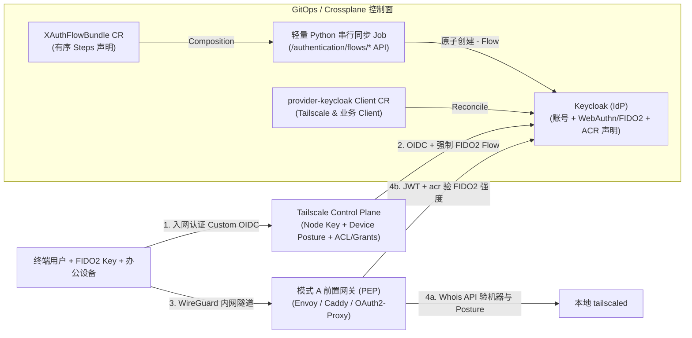

# Tailscale + Keycloak（FIDO2）零信任 IAM 与 Crossplane 台账设计方案

> **适用范围**：PITS Infra 零信任身份与接入控制面（Tailscale + Keycloak IdP + Crossplane 声明式台账）  
> **核心原则**：**Keycloak 管“人 + FIDO2 强认证”、Tailscale 管“机器身份 + Device Posture + 网络隧道”、模式 A 网关做“联合裁决”、Crossplane 管“无竞态声明式台账”**

---

## 1. 架构总览与核心分工

本方案采用 **BeyondCorp / 零信任双因子联合校验模型（模式 A：网络与网关层拦截，业务零侵入）**，并通过 Crossplane 实现配置台账的 GitOps 闭环：



| 组件 | 核心职责 | 解决的问题 |
| :--- | :--- | :--- |
| **Keycloak (IdP)** | 人员身份源、WebAuthn/FIDO2 强制认证、OIDC Token 签发、认证强度声明（`acr`/`amr`）、RBAC 组与角色 | 确认**“是谁”**以及**“是否通过 FIDO2 硬件密钥完成强认证”** |
| **Tailscale (Network + Device IAM)** | 设备公钥（Node Key）、Device Posture（OS/加密/EDR 合规标签）、节点过期（Key Expiry）、Grants 放行策略 | 确认**“从哪台机器来”**、**“机器是否合规”**，并收敛所有内网入口 |
| **模式 A 前置网关 (PEP)** | 调用本地 `tailscaled` Whois API 验机器上下文 + 校验 Keycloak JWT 及 `acr` 等级 | 在单次请求上下文中完成**“人（FIDO2）+ 合规机器”**的同步校验 |
| **Crossplane（配置台账）** | `crossplane-contrib/provider-keycloak` 管 `Realm`/`Client`/`Group`；自定义 `XAuthFlowBundle` 管有序 FIDO2 认证流 | 实现 K8s 原生声明式台账、漂移纠偏（Drift Detection）与应用自助接入 |

---

## 2. 关键设计决策：为什么采用“蓝绿 Hash Flow + 原生 REST API 串行器”

### 2.1 避坑：`provider-keycloak` 并发竞态与 `partialImport` 限制
1. **`provider-keycloak` 的 `Execution` 并发乱序坑**：Crossplane 各 Managed Resource 默认并发 Reconcile。若一个 Flow 下声明多个 `authenticationflow.keycloak.crossplane.io/v1alpha1` (`Execution`) CR，它们并发调用 Keycloak API 时极易导致 `priority`/执行顺序打架。
2. **`partialImport` 端点陷阱**：Keycloak 原生 `POST /admin/realms/{realm}/partialImport` 底层 `ResourceType` 枚举仅支持 `USER`、`GROUP`、`CLIENT`、`IDP`、`IDP_MAPPER`、`REALM_ROLE`、`CLIENT_ROLE`，**并不支持 `authenticationFlows`**（传入会被静默忽略返回 `200 OK`，并导致后续 Client 绑定抛 `Unable to resolve auth flow binding override`）。
3. **`provider-http` 的局限**：`crossplane-contrib/provider-http` 的 Bearer Token 注入仅支持静态 Secret 引用（`{{ secret:ns:key }}`），不适合“先做 OAuth2 `client_credentials` 换取短期 Token，再按顺序循环调用多个有前后依赖的 REST API”。

### 2.2 方案二最终设计
- **上层体验无感知**：平台/管理员在 GitOps 中仅提交一个 Crossplane `AuthFlowBundle` CR，按顺序数组声明 `steps` 和嵌套 `subflow`。
- **底层轻量串行执行**：Crossplane Composition 使用 `function-go-templating` 计算配置摘要 `hash = sha256sum | trunc 8`，通过 `provider-kubernetes` 拉起一个 ~15MB 的 `python:3.12-alpine` 极简 Job（零第三方 pip 依赖、无 JVM 开销），单线程串行调用 Keycloak 官方 `/admin/realms/{realm}/authentication/...` 接口。
- **不可变蓝绿无损切换**：每次 Flow 变更创建新版本 **`<flowAlias>-<hash>`**，待内部所有 Execution 与 Subflow 装配就绪后再原子切换绑定并清理未被占用的老版本，彻底消除并发乱序和线上修改窗口期的登录异常。

---

## 3. 前置准备

### 3.1 Crossplane 组件清单
确保目标控制面集群已安装：
- `crossplane-contrib/provider-keycloak`（管理 `Realm`、`Client`、`Group` 等）
- `crossplane-contrib/provider-kubernetes`（调度 Flow 同步 `ConfigMap` 与 `Job`）
- `crossplane-contrib/function-go-templating`（渲染配置 JSON 与计算 `sha256sum`）
- `crossplane-contrib/function-auto-ready`（等待 Job `Succeeded` 后标记 XR 就绪）

### 3.2 Keycloak Service Account 凭据
在 Keycloak `master` Realm 创建一个 `CONFIDENTIAL` 类型 Client（如 `crossplane-iam-sync`），开启 **Service Accounts Roles** 并赋予目标 Realm（如 `corp`）的 `manage-realm`（或 `realm-admin`）权限，创建 Secret：

```yaml
apiVersion: v1
kind: Secret
metadata:
  name: keycloak-sync-creds
  namespace: keycloak
type: Opaque
stringData:
  KEYCLOAK_URL: "http://keycloak.keycloak.svc.cluster.local:8080"
  KEYCLOAK_TOKEN_REALM: "master"
  KEYCLOAK_CLIENT_ID: "crossplane-iam-sync"
  KEYCLOAK_CLIENT_SECRET: "<your-client-secret>"
```

---

## 4. 轻量串行同步脚本（Python 标准库零依赖）

将以下脚本存入 `ConfigMap`，仅使用 Python 3 标准库（`urllib`、`json`、`os`）：

```yaml
apiVersion: v1
kind: ConfigMap
metadata:
  name: keycloak-flow-sync-script
  namespace: keycloak
data:
  sync_flow.py: |
    import json
    import os
    import urllib.error
    import urllib.parse
    import urllib.request

    BASE_URL = os.environ["KEYCLOAK_URL"].rstrip("/")
    TOKEN_REALM = os.environ.get("KEYCLOAK_TOKEN_REALM", "master")
    CLIENT_ID = os.environ["KEYCLOAK_CLIENT_ID"]
    CLIENT_SECRET = os.environ["KEYCLOAK_CLIENT_SECRET"]
    SPEC_PATH = os.environ.get("FLOW_SPEC_PATH", "/config/flow-spec.json")


    def http_request(method, url, token=None, data=None, form=False):
        headers = {}
        body = None
        if token:
            headers["Authorization"] = f"Bearer {token}"
        if data is not None:
            if form:
                headers["Content-Type"] = "application/x-www-form-urlencoded"
                body = urllib.parse.urlencode(data).encode("utf-8")
            else:
                headers["Content-Type"] = "application/json"
                body = json.dumps(data).encode("utf-8")
        req = urllib.request.Request(url, data=body, headers=headers, method=method)
        try:
            with urllib.request.urlopen(req, timeout=30) as resp:
                raw = resp.read().decode("utf-8")
                return resp.status, json.loads(raw) if raw else None
        except urllib.error.HTTPError as e:
            err_body = e.read().decode("utf-8", errors="replace")
            raise RuntimeError(f"HTTP {e.code} {method} {url}: {err_body}") from e


    def get_token():
        url = f"{BASE_URL}/realms/{TOKEN_REALM}/protocol/openid-connect/token"
        _, resp = http_request(
            "POST",
            url,
            data={
                "grant_type": "client_credentials",
                "client_id": CLIENT_ID,
                "client_secret": CLIENT_SECRET,
            },
            form=True,
        )
        return resp["access_token"]


    def encode_alias(alias):
        return urllib.parse.quote(alias, safe="")


    def list_flows(token, realm):
        url = f"{BASE_URL}/admin/realms/{realm}/authentication/flows"
        _, flows = http_request("GET", url, token=token)
        return flows


    def list_executions(token, realm, flow_alias):
        url = f"{BASE_URL}/admin/realms/{realm}/authentication/flows/{encode_alias(flow_alias)}/executions"
        _, execs = http_request("GET", url, token=token)
        return execs


    def get_realm(token, realm):
        url = f"{BASE_URL}/admin/realms/{realm}"
        _, data = http_request("GET", url, token=token)
        return data


    def list_clients(token, realm):
        url = f"{BASE_URL}/admin/realms/{realm}/clients?max=1000"
        _, data = http_request("GET", url, token=token)
        return data


    def populate_steps(token, realm, parent_alias, steps):
        for idx, step in enumerate(steps):
            step_type = step.get("type", "execution")
            requirement = step.get("requirement", "REQUIRED")
            before_ids = {e["id"] for e in list_executions(token, realm, parent_alias)}

            if step_type == "subflow":
                sub_alias = step["alias"]
                http_request(
                    "POST",
                    f"{BASE_URL}/admin/realms/{realm}/authentication/flows/{encode_alias(parent_alias)}/executions/flow",
                    token=token,
                    data={
                        "alias": sub_alias,
                        "type": step.get("flowType", "basic-flow"),
                        "description": step.get("description", ""),
                        "provider": step.get("provider", "registration-page-form"),
                    },
                )
                after_execs = list_executions(token, realm, parent_alias)
                created = [e for e in after_execs if e["id"] not in before_ids]
                if not created:
                    raise RuntimeError(f"Failed to locate created subflow '{sub_alias}' under '{parent_alias}'")
                target_exec = created[-1]
                target_exec["requirement"] = requirement
                http_request(
                    "PUT",
                    f"{BASE_URL}/admin/realms/{realm}/authentication/flows/{encode_alias(parent_alias)}/executions",
                    token=token,
                    data=target_exec,
                )
                populate_steps(token, realm, sub_alias, step.get("steps", []))

            elif step_type == "execution":
                provider = step["provider"]
                http_request(
                    "POST",
                    f"{BASE_URL}/admin/realms/{realm}/authentication/flows/{encode_alias(parent_alias)}/executions/execution",
                    token=token,
                    data={"provider": provider},
                )
                after_execs = list_executions(token, realm, parent_alias)
                created = [e for e in after_execs if e["id"] not in before_ids]
                if not created:
                    raise RuntimeError(f"Failed to locate created execution '{provider}' under '{parent_alias}'")
                target_exec = created[-1]
                target_exec["requirement"] = requirement
                http_request(
                    "PUT",
                    f"{BASE_URL}/admin/realms/{realm}/authentication/flows/{encode_alias(parent_alias)}/executions",
                    token=token,
                    data=target_exec,
                )
                if step.get("config"):
                    cfg_alias = step.get("configAlias") or f"{parent_alias}-{provider}-{idx}"
                    http_request(
                        "POST",
                        f"{BASE_URL}/admin/realms/{realm}/authentication/executions/{target_exec['id']}/config",
                        token=token,
                        data={"alias": cfg_alias, "config": step["config"]},
                    )
            else:
                raise ValueError(f"Unknown step type: {step_type}")


    def cleanup_old_flows(token, realm, base_alias, current_alias):
        prefix = f"{base_alias}-"
        realm_rep = get_realm(token, realm)
        bound_aliases = {
            realm_rep.get("browserFlow"),
            realm_rep.get("registrationFlow"),
            realm_rep.get("directGrantFlow"),
            realm_rep.get("resetCredentialsFlow"),
            realm_rep.get("clientAuthenticationFlow"),
            realm_rep.get("dockerAuthenticationFlow"),
        }
        bound_ids = set()
        for c in list_clients(token, realm):
            overrides = c.get("authenticationFlowBindingOverrides") or {}
            for flow_id in overrides.values():
                if flow_id:
                    bound_ids.add(flow_id)

        for f in list_flows(token, realm):
            alias = f.get("alias", "")
            fid = f.get("id")
            if alias.startswith(prefix) and alias != current_alias and not f.get("builtIn"):
                if alias in bound_aliases or fid in bound_ids:
                    print(f"[skip cleanup] flow {alias} ({fid}) is still bound")
                    continue
                print(f"[cleanup] deleting unused old flow {alias} ({fid})")
                http_request(
                    "DELETE",
                    f"{BASE_URL}/admin/realms/{realm}/authentication/flows/{fid}",
                    token=token,
                )


    def main():
        with open(SPEC_PATH, "r", encoding="utf-8") as f:
            spec = json.load(f)

        realm = spec["realm"]
        base_alias = spec["baseAlias"]
        target_alias = spec["targetAlias"]
        description = spec.get("description", "")
        steps = spec.get("steps", [])
        bind_realm_browser = spec.get("bindAsRealmBrowserFlow", False)
        cleanup_old = spec.get("cleanupUnusedVersions", True)

        token = get_token()
        existing = {f["alias"]: f for f in list_flows(token, realm)}

        # 若目标蓝绿版本已存在且未被绑定，则先删除以保证重试幂等干净
        if target_alias in existing:
            old_id = existing[target_alias]["id"]
            realm_rep = get_realm(token, realm)
            if realm_rep.get("browserFlow") == target_alias:
                print(f"[ok] flow {target_alias} ({old_id}) already active & bound; skipping recreate")
                return
            print(f"[retry-reset] deleting incomplete unbound flow {target_alias} ({old_id})")
            http_request(
                "DELETE",
                f"{BASE_URL}/admin/realms/{realm}/authentication/flows/{old_id}",
                token=token,
            )

        print(f"[create] top-level flow {target_alias} in realm {realm}")
        http_request(
            "POST",
            f"{BASE_URL}/admin/realms/{realm}/authentication/flows",
            token=token,
            data={
                "alias": target_alias,
                "description": description,
                "providerId": "basic-flow",
                "topLevel": True,
                "builtIn": False,
            },
        )

        populate_steps(token, realm, target_alias, steps)

        if bind_realm_browser:
            print(f"[bind] setting realm '{realm}' browserFlow -> '{target_alias}'")
            realm_rep = get_realm(token, realm)
            realm_rep["browserFlow"] = target_alias
            http_request("PUT", f"{BASE_URL}/admin/realms/{realm}", token=token, data=realm_rep)

        if cleanup_old:
            cleanup_old_flows(token, realm, base_alias, target_alias)

        flows_after = {f["alias"]: f for f in list_flows(token, realm)}
        flow_id = flows_after[target_alias]["id"]
        print(f"[done] synced flow alias={target_alias} id={flow_id}")


    if __name__ == "__main__":
        main()
```

---

## 5. Crossplane `XRD` 与 `Composition` 清单

### 5.1 `CompositeResourceDefinition` (`XAuthFlowBundle` / `AuthFlowBundle`)

```yaml
apiVersion: apiextensions.crossplane.io/v1
kind: CompositeResourceDefinition
metadata:
  name: xauthflowbundles.iam.corp.io
spec:
  group: iam.corp.io
  names:
    kind: XAuthFlowBundle
    plural: xauthflowbundles
  claimNames:
    kind: AuthFlowBundle
    plural: authflowbundles
  versions:
    - name: v1alpha1
      served: true
      referenceable: true
      schema:
        openAPIV3Schema:
          type: object
          properties:
            spec:
              type: object
              required:
                - realm
                - flowAlias
                - steps
              properties:
                realm:
                  type: string
                flowAlias:
                  type: string
                description:
                  type: string
                bindAsRealmBrowserFlow:
                  type: boolean
                  default: false
                cleanupUnusedVersions:
                  type: boolean
                  default: true
                steps:
                  type: array
                  items:
                    type: object
                    x-kubernetes-preserve-unknown-fields: true
            status:
              type: object
              properties:
                activeFlowAlias:
                  type: string
```

### 5.2 `Composition`（`function-go-templating` + `provider-kubernetes`）

```yaml
apiVersion: apiextensions.crossplane.io/v1
kind: Composition
metadata:
  name: keycloak-flow-native-api
spec:
  compositeTypeRef:
    apiVersion: iam.corp.io/v1alpha1
    kind: XAuthFlowBundle
  mode: Pipeline
  pipeline:
    - step: render-sync-job
      functionRef:
        name: function-go-templating
      input:
        apiVersion: gotemplating.fn.crossplane.io/v1beta1
        kind: GoTemplate
        source: Inline
        inline:
          template: |
            {{- $xr := .observed.composite.resource -}}
            {{- $rawSpec := dict
                "realm" $xr.spec.realm
                "baseAlias" $xr.spec.flowAlias
                "description" ($xr.spec.description | default "")
                "bindAsRealmBrowserFlow" ($xr.spec.bindAsRealmBrowserFlow | default false)
                "cleanupUnusedVersions" ($xr.spec.cleanupUnusedVersions | default true)
                "steps" $xr.spec.steps | toJson -}}
            {{- $hash := $rawSpec | sha256sum | trunc 8 -}}
            {{- $targetAlias := printf "%s-%s" $xr.spec.flowAlias $hash -}}
            {{- $finalSpec := dict
                "realm" $xr.spec.realm
                "baseAlias" $xr.spec.flowAlias
                "targetAlias" $targetAlias
                "description" ($xr.spec.description | default "")
                "bindAsRealmBrowserFlow" ($xr.spec.bindAsRealmBrowserFlow | default false)
                "cleanupUnusedVersions" ($xr.spec.cleanupUnusedVersions | default true)
                "steps" $xr.spec.steps | toPrettyJson -}}
            ---
            apiVersion: iam.corp.io/v1alpha1
            kind: XAuthFlowBundle
            status:
              activeFlowAlias: {{ $targetAlias | quote }}
            ---
            apiVersion: kubernetes.crossplane.io/v1alpha1
            kind: Object
            metadata:
              annotations:
                gotemplating.fn.crossplane.io/composition-resource-name: flow-spec-cm
            spec:
              providerConfigRef:
                name: default
              forProvider:
                manifest:
                  apiVersion: v1
                  kind: ConfigMap
                  metadata:
                    name: flow-spec-{{ $xr.metadata.name }}
                    namespace: keycloak
                  data:
                    flow-spec.json: |
            {{ $finalSpec | indent 12 }}
            ---
            apiVersion: kubernetes.crossplane.io/v1alpha1
            kind: Object
            metadata:
              annotations:
                gotemplating.fn.crossplane.io/composition-resource-name: flow-sync-job
            spec:
              providerConfigRef:
                name: default
              forProvider:
                manifest:
                  apiVersion: batch/v1
                  kind: Job
                  metadata:
                    name: flow-sync-{{ $xr.metadata.name }}-{{ $hash }}
                    namespace: keycloak
                  spec:
                    backoffLimit: 3
                    ttlSecondsAfterFinished: 3600
                    template:
                      spec:
                        restartPolicy: OnFailure
                        containers:
                          - name: sync
                            image: python:3.12-alpine
                            command: ["python3", "/scripts/sync_flow.py"]
                            envFrom:
                              - secretRef:
                                  name: keycloak-sync-creds
                            env:
                              - name: FLOW_SPEC_PATH
                                value: /config/flow-spec.json
                            volumeMounts:
                              - name: spec
                                mountPath: /config
                              - name: script
                                mountPath: /scripts
                        volumes:
                          - name: spec
                            configMap:
                              name: flow-spec-{{ $xr.metadata.name }}
                          - name: script
                            configMap:
                              name: keycloak-flow-sync-script
    - step: auto-ready
      functionRef:
        name: function-auto-ready
```

---

## 6. 业务侧使用示例（强制 FIDO2 Flow + `provider-keycloak` Client）

### 6.1 声明强制 FIDO2 Browser Flow

```yaml
apiVersion: iam.corp.io/v1alpha1
kind: AuthFlowBundle
metadata:
  name: corp-fido2-browser
  namespace: iam-system
spec:
  realm: corp
  flowAlias: corp-fido2-browser
  description: "Tailscale & Mode-A Gateway mandatory FIDO2 browser flow"
  bindAsRealmBrowserFlow: true
  cleanupUnusedVersions: true
  steps:
    - type: execution
      provider: auth-cookie
      requirement: ALTERNATIVE
    - type: subflow
      alias: corp-fido2-password-and-key
      flowType: basic-flow
      requirement: ALTERNATIVE
      steps:
        - type: execution
          provider: auth-username-password-form
          requirement: REQUIRED
        - type: execution
          # 请先在目标 Keycloak 查询 /authentication/authenticator-providers 确认实际 ID
          # （常见为 webauthn-authenticator 或无密码场景 webauthn-authenticator-passwordless）
          provider: webauthn-authenticator
          requirement: REQUIRED
```

### 6.2 `provider-keycloak` 管理的 Realm 与 Tailscale Custom OIDC Client

```yaml
apiVersion: realm.keycloak.crossplane.io/v1alpha1
kind: Realm
metadata:
  name: corp-realm
spec:
  forProvider:
    realm: corp
    enabled: true
    displayName: "Corp Zero-Trust IAM"
    # 锁定 FIDO2 RP ID，切勿随意变更域名
    webAuthnPolicy:
      - rpEntityName: "Corp SSO"
        rpId: "sso.corp.example.com"
        userVerificationRequirement: "required"
  providerConfigRef:
    name: keycloak-provider-config
---
apiVersion: openidclient.keycloak.crossplane.io/v1alpha1
kind: Client
metadata:
  name: tailscale-custom-oidc
spec:
  forProvider:
    realmIdRef:
      name: corp-realm
    clientId: "tailscale-control-plane"
    name: "Tailscale Custom OIDC"
    accessType: "CONFIDENTIAL"
    standardFlowEnabled: true
    validRedirectUris:
      - "https://login.tailscale.com/a/oauth_response"
  writeConnectionSecretToRef:
    name: tailscale-oidc-secret
    namespace: iam-system
  providerConfigRef:
    name: keycloak-provider-config
```

> **提示**：若某高敏 Client 需独立覆写而非共享 Realm 默认 `browserFlow`，可将 `bindAsRealmBrowserFlow` 设为 `false`，利用 `sync_flow.py` 获取的 Flow UUID 在 `Client` 的 `authenticationFlowBindingOverrides` 中进行绑定；注意当 `Realm` CR 与 `sync_flow.py` 同时存在时，请确保 `provider-keycloak` 的 `Realm` CR 中不要把 `browserFlow` 硬编码回默认 `"browser"`（可留空不管理该字段，交由 `AuthFlowBundle` 托管）。

---

## 7. 上线前验证 Checklist

1. **核对 WebAuthn Provider ID**：在目标 Keycloak 执行 `GET /admin/realms/corp/authentication/authenticator-providers`，确认 `webauthn-authenticator`（或无密码 Passkey `webauthn-authenticator-passwordless`）的精确 `id`。
2. **确认 ACR / AMR 声明透传**：确保模式 A 网关的 Client 开启了 `acr` Client Scope/Mapper，并在前置网关校验 Token 中的 `acr`/`amr` 确认为硬件密钥认证。
3. **Tailscale 台账与标签规范**：
   - 员工终端保持 **User-owned**（不要打 `tag:`，否则会丢失 Keycloak 用户身份属性），设备合规属性用 **Device Posture / Custom Attributes**；
   - Tailscale ACL / Grants 保持单一全局文档由平台统一维护，避免多 Composition 相互覆盖；
   - `tag:` 仅用于服务器、模式 A 网关等基础设施节点。
4. **用户生命周期与凭证边界**：人员账号由上游目录（LDAP / AD / Entra ID / HR）同步进 Keycloak，FIDO2 Key 由员工自助绑定，**不在 Crossplane CR 中硬编码个人 `User` 台账**。
5. **应急防锁死（Break-glass）**：保留至少一个不依赖外部 OIDC 的受控应急入口（如受限 Auth Key 或带外运维通道），防止 Keycloak 维护窗口期间无法登录 Tailscale 控制台。
